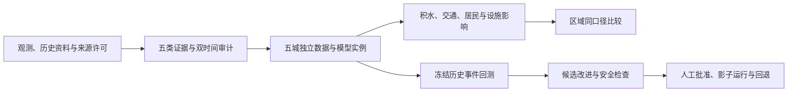

# 五城复合内涝世界模型 · Five-City Urban Flood World Model

面向**上海、宁波、福州、深圳、海口**的城市内涝韧性研究项目。我们研究台风、极端暴雨、潮位、河流与城市排水如何共同影响积水，并进一步分析居民、交通、关键设施和应急部门的影响与响应。研究事件**不限于台风**，也包括独立暴雨及其他复合致涝过程。

> **项目状态：公开研究工作台与数据/事件基础设施可运行；五城预测模型尚未交付。** [公开网站](https://tenetjustin.github.io/cityos-flood/)部署在 GitHub Pages，为只读静态目录，不接入实时后端。当前模型能力主要来自深圳实验原型。其余四城已有研究范围和来源登记，但没有经过独立事件验证的城市模型。此项目不是官方实况平台、公众预警系统或自动调度系统。

## 研究范围与当前状态

| 城市 | 重点耦合过程 | 当前实现 |
|---|---|---|
| 上海 | 暴雨、潮位、河网顶托 | 城市配置与候选来源登记；模型和事件数据待接入 |
| 宁波 | 台风、风暴潮、河流洪水 | 城市配置与候选来源登记；模型和事件数据待接入 |
| 福州 | 短历时暴雨、山洪、闽江潮位顶托 | 城市配置与候选来源登记；模型和事件数据待接入 |
| 深圳 | 台风、暴雨、潮位、快速汇流 | 研究型模型、地图与情景页面；仍缺独立历史真值和完整实时源 |
| 海口 | 台风、风暴潮、低洼区积水 | 城市配置与候选来源登记；模型和事件数据待接入 |

五城共用的是**证据契约和建模方法**，不是一套可以直接复制的城市参数。世界模型的目标是连接气象、海洋和水文强迫，城市地形与排水状态，以及暴露和行动反馈，形成可回放的事件链。每城都需单独确认边界条件、设施/人口暴露及事件外验证；区域层只能比较口径一致、验证状态明确的结果。

## 系统如何组成



这是[目标架构](docs/SOUTHEAST_ARCHITECTURE.md)，并非所有连线已实现。特别是跨城模型、真实行为反馈和受控 RSI 版本晋级闭环尚未完成。

### 已实现的研究基础设施

- **五城研究工作台**：总览、城市、事件、模型、来源、复核与深圳实验区均有独立路径；地图是城市空间索引，检查器解释来源与缺口。GitHub Pages 公开版本仅展示 2026-10-19 核对的目录快照，不刷新或宣称实时实测。旧深圳代码仍在仓库，但公开站仅提供实验索引，不运行依赖后端的原型。[网站交付与部署边界](docs/WEBSITE_DELIVERY.md)
- **事件证据契约**：按 `observation`（观测记录，仍须核验）、`historical_record`（历史记录）、`model_inference`（模型推断）、`simulation_scenario`（模拟情景）和 `missing`（缺失）分类，保存来源、许可、质量、空间/高程基准、单位与时间。事件包可由 `GET /api/region/events/{city_id}/{event_id}` 读取并做结构校验。[完整契约](docs/FIVE_CITY_EVENT_CONTRACT.md)
- **实时观测接入边界**：可通过带令牌的 `POST /api/realtime/intake` 接收规范化记录，在外部数据目录持久化；`GET /api/realtime/snapshot` 只做计数、极值、均值、时效和缺失覆盖等**描述性分析**。提交数据一律标为“来源未独立核验”，不会自动进入预测模型。[来源注册表与晋级条件](docs/REALTIME_SOURCE_REGISTRY.md)
- **离线历史回测评估器**：`backend/app/historical_replay.py` 对已校验事件包、当时签发的预报和合格独立观测做时间泄漏与匹配检查；缺关键证据时拒绝给出有效技巧结论。它不训练模型或更改版本。
- **深圳实验能力**：已有 GIS、水网/排水、内涝预测、潮位/台风情景、居民影响和方案建议等模块，其中包含参数化假设、模型推断及可能的回退样本；不能整体解释为核验后的实时事实。[数据证据与真实性债务](docs/FIVE_CITY_DATA_EVIDENCE.md)

### 尚未完成的关键门槛

目前五城来源注册表中**没有通过全部核验条件的实时来源**。网站具备接入能力，不代表已经持续接入五城官方数据。上海、宁波、福州、海口的城市模型尚未建立和验证；真实居民/部门行动、交通中断与恢复数据亦未形成可用于影响模型的完整样本。区域统筹和受控 RSI 仍属目标架构。

模型版本只能在来源复核、独立事件回测、泄漏与安全检查、人工批准和影子运行之后晋级；任何自动候选调整都不能自行改动模型、安全阈值或现实设施。

## 数据与真实性原则

统一业务时区为 `Asia/Shanghai`（UTC+08:00）。`observed_at` 表示现象发生/被观测的时间；`available_at` 表示该**版本**实际可供当时运行读取的时间。供应方发布时间、系统接收时间和本项目下载时间不能相互冒充。历史回测在起报时刻只能使用当时已经可获得的版本。

每条记录还需明确空间坐标系、必要的水位高程基准、原单位、来源引用、许可和质量标记。未知值保留为缺失，不能填零，也不能把卫星反演、再分析、旧新闻或模拟行为标成独立观测真值。数据文件存在或结构检查通过，不代表来源真实性、准确性和再分发许可已通过审核。

首个端到端候选为[深圳 2023 年“9·7”极端暴雨](docs/events/2023-09-07_SHENZHEN_EVIDENCE.md)。目前可核对官方事后记录和部分日尺度估计，但缺逐站双时间观测、独立积水深度及当时签发的预报快照，**尚不能完成有效的历史预测技巧回测**；也没有可据此编写居民真实反应的样本。

## 快速开始

建议 Python 3.12、Node.js 18+。从仓库根目录启动：

```bash
python3.12 -m venv backend/.venv
backend/.venv/bin/python -m pip install -r backend/requirements.txt
backend/.venv/bin/python -m uvicorn backend.app.main:app --host 127.0.0.1 --port 8000
```

开发网站请在另一个终端运行：

```bash
cd frontend
npm ci
npm run dev
```

打开 `http://127.0.0.1:5173/`。若改用单进程本地运行，请先停止上述开发服务器，再从仓库根目录构建网站；后端启动时会在 `/` 提供页面（`/api` 仍是接口）：

```bash
cd frontend && npm ci && npm run build
cd ..
backend/.venv/bin/python -m uvicorn backend.app.main:app --host 127.0.0.1 --port 8000
```

这只是本地研究运行方式，不是生产部署配置。可选研究数据默认位于 `backend/data/external/`；也可用 `CITYOS_EXTERNAL_DATA_DIR` 指向获授权、可写的外部目录。实时写入还需设置 `CITYOS_REALTIME_INGEST_TOKEN`；未设置时写接口关闭。**不要将令牌、受限原始数据或未审查的模型文件提交到仓库。** 具体输入契约、存储和部署要求见[网站交付说明](docs/WEBSITE_DELIVERY.md)。

GitHub Pages 从 `main` 的前端变更自动构建，基路径为 `/cityos-flood/`，深链接通过 `404.html` 回退到前端路由。它不运行 FastAPI；若要安全地公开实时描述性分析，需要另行部署并审计后端、身份、许可与数据保护，不能只修改静态站配置。

## 验证

```bash
backend/.venv/bin/python -m unittest discover -s tests
backend/.venv/bin/python -m backend.app.evidence_audit
cd frontend && npm test && npm run build
```

测试中的假提供方只验证接入契约，不能证明实际数据源可用。证据审计只检查本地结构和已知缺口；外部人口、潮位或历史事件文件缺失时的跳过/失败，也不能解释为通过真实性验证。历史回测结果必须连同事件包、数据版本、起报时刻和模型版本复核。

## 文档导航

- [五城总体架构与受控 RSI 门槛](docs/SOUTHEAST_ARCHITECTURE.md)
- [共享事件与数据契约](docs/FIVE_CITY_EVENT_CONTRACT.md)
- [五城来源、事件候选和获取缺口](docs/FIVE_CITY_SOURCE_EVENT_REGISTER.md)
- [实时来源注册表](docs/REALTIME_SOURCE_REGISTRY.md)
- [分阶段研究路线](docs/REGIONAL_RESEARCH_ROADMAP.md)
- [网站交付与接入说明](docs/WEBSITE_DELIVERY.md)

## 使用边界

本仓库用于研究、事件复盘和方法验证。当前**不具备公众预警、自动泵闸调度、道路管制或救援指挥资格**。即使网站展示了近期记录或模型结果，也不代表全市观测完整、预测经过独立验证，或主管部门已批准采取行动。
