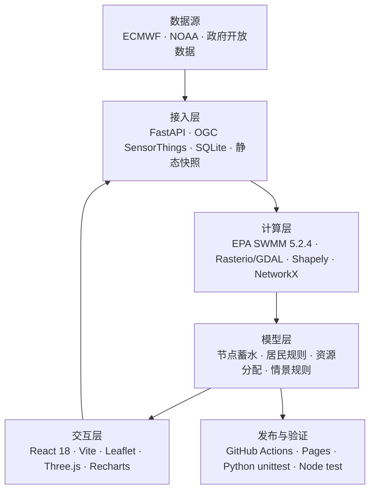

# CityOS 产品说明：工作流、证据与方法

更新：2026-10-21。本文说明当前发布的浙江四城研究工作台，不代表已具备城市级积水预测或应急指挥能力。

## 产品目标

CityOS 将公开或经授权取得的观测、历史记录、天气模式推断与用户设置的模拟情景组织在同一工作流中，帮助研究者检查数据质量、比较风险驱动因素、复核影响线索并形成待审批的建议草案。当前研究范围为宁波、台州、温州、杭州；城市参数不能因界面共用而视作相同。

用户主流程：

1. 在“实时态势”切换“演示数据 / 真实来源”。演示模式查看一个登陆前24小时至登陆后48小时、共73个逐小时时点的模拟台风过程。地图、路径、四城状态、2D城市风险曲线、居民影响情景、逐点建议和3D合成街区共享同一时间控件；每6小时为一个情景更新周期。真实来源模式仅显示实际接入且通过契约检查的数据，缺失时明确显示待核实。
2. 在“影响与建议”查看预置规则给出的初步分析、人工复核事项和建议措施；演示模式展示逐点地图、按小时变化的居民影响情景、点位关联的核查建议及提前准备事项。建议使用演示点位编号、情景水深和相对台风时刻，不表示现实中该处已发生内涝。人工清单只保存在当前浏览器会话，不发送给部门或自动执行。
3. 在“推演”选择“自定义情景”调整环境和响应条件、查看城市级核查压力示意和方案比较，或选择“历史回溯”查看已登记的历史事件与资料。自定义推演只使用用户当前输入/可选公开天气模式，不读取态势演示快照；示例数据不列入历史事件库。
4. “产品说明”是独立说明页，不占工作区；包含来源、许可、模型规则、技术栈、质量和使用边界。

## 字体与许可

工作台使用 [Leon Sans 2.0](https://github.com/cmiscm/leonsansfont) 可变字体显示拉丁文字与界面标题，依据 SIL Open Font License 1.1 通过 jsDelivr 加载；中文字符回退至 Noto Sans SC，数据数字仍使用 IBM Plex Mono。若将字体文件改为随站点托管，须一并保留字体许可与署名文件。若外部 CDN 不可用，浏览器会回退至系统无衬线字体。

## 三个工作区及现行能力

| 栏目 | 当前可交互功能 | 证据边界 |
|---|---|---|
| 实时态势 | 四城状态卡（所选小时动态更新）、公开天气模式格点、模拟台风路径与雨量/内涝筛查图层、四城逐小时风险曲线、可旋转的相对高程3D微区及独立自定义情景预演；值守速览按优先级列点位、当前水深、情景暴露量和建议准备的力量类型 | `zhejiang-demo-snapshot.json` 与真实源快照物理隔离。输入为合成；节点水深由SWMM计算，居民为规则估算，队伍为容量优化候选，不是台风预报或已验证的城市积水预测。真实模式仅按已取得来源记录呈现。天气降雨是模式推断，不代表城区雨量或积水。 |
| 影响与建议 | 预置规则初步研判、人工复核清单、建议措施；演示模式展示四城100个微区筛查点（每城25个）、逐时水深、优先级排序、微区聚合居民影响情景和按点位变化的部门资源建议；真实来源模式展示登记的积水/影响/部门记录 | 点位是合成微区网格，不对应真实街道或已核验易涝点；水深不是地面观测。居民影响为规则估算，不代表居民实际行为，不展示个人轨迹。部门区域展示的是待人工复核建议，不是部门实况或已执行调度；人工勾选清单仅保存在当前页面会话。 |
| 推演 | 自定义环境/响应假设、城市级规则压力示意、方案比较和本机预案草案；独立历史事件选择、动态最佳路径与已登记环境资料回看；不读取态势演示快照 | `tabletop-rules-v1` 输出离散核查压力而非积水等级或概率；用户调整的是明确的推演输入。历史事件仅展示登记的历史记录，演示点位不进入历史事件库。IBTrACS 快照只覆盖最近三年，早期事件无匹配路径时显示缺失。 |
| 产品说明 | 独立说明页和仓库技术文档：功能、技术栈、来源许可、时间/空间口径、质量标记、规则公式、模型版本及安全边界 | 说明文档不占日常工作区；来源目录存在不等于平台申请已批准或数据已接入。缺值不填零。 |

旧链接保持兼容：`/workbench/:city/points` 转至实时态势，`/decision` 转至影响与建议，`/events` 转至推演中的历史回溯入口；原“数据与方法”地址转至产品说明来源章节。

## 演示数据集（与真实数据隔离）

静态演示集由 [`frontend/scripts/generate-zhejiang-demo.mjs`](../frontend/scripts/generate-zhejiang-demo.mjs) 生成，存于 [`frontend/public/data/zhejiang-demo-snapshot.json`](../frontend/public/data/zhejiang-demo-snapshot.json)，结构校验位于 [`zhejiangDemoData.js`](../frontend/src/zhejiangDemoData.js)。空间检查用 GeoJSON 快照 [`zhejiang-demo-peak.geojson`](../frontend/public/data/zhejiang-demo-peak.geojson)，可直接导入 QGIS/GDAL 作图层核查。`dataset_type=simulated_demo`、数据标签“模拟台风演示 · 非实时数据”（页面只显示“演示”状态）、逐条 `evidence_type=simulated_scenario` 及 `source_id=synthetic-typhoon-v3` 是必需标记。时区为 Asia/Shanghai，台风登陆时刻记为相对时刻 T0；时间范围为登陆前24小时至登陆后48小时，固定1小时步长。`observation_time` 与 `actual_available_at` 明确为 null，因为该演示没有真实观测或供应方可获得时间。坐标声明为 EPSG:4326，雨强/累计雨量单位为 mm/h 与 mm，水深单位为 cm，影响人数仅为合成聚合值；质量标记为 `synthetic_demo_only`，缺失值使用 null。

数据包保存四城逐小时驱动、100个合成微区、73个台风路径时刻、每城13条六小时建议，以及EPA SWMM 5.2.4实际计算的100×73节点蓄水序列。前端从同一求解器结果计算排序、居民影响和建议，并联动地图、二维点位矩阵与三维地形。点击二维点位可查看全过程水深、影响人数与NetworkX候选队伍；可导出当前复核包。6小时是建议汇集周期，不是新的真实观测或滚动预报。三维水斑是点位符号，不是二维淹没面积。[完整复现、验收与工程替代方案](OPEN_SOURCE_DELIVERY.md)。

### 模拟台风逐小时生成规则

以下先说明合成气象输入及保留的旧筛查基线。发布演示的水深已由EPA SWMM替代旧D_cm公式；`model.engine=epa_swmm`时缺少求解结果会拒绝数据，不回退成公式输出。独立自定义推演仍是浏览器规则沙盘。设相对台风登陆时间 `e = hour - 24`，合成小时雨强为两个平滑雨带：

```text
rain_t = R × exp(-0.5 × ((e - peak) / width)^2)
       + 0.38R × exp(-0.5 × ((e - peak - 14) / (1.2 × width))^2)
rain_6h = Σ rain_(t-5...t)
memory_t = clamp(0.87 × memory_(t-1) + 0.13 × rain_t / 65, 0, 1)
river_t = clamp(river_base + 0.25 × clamp(rain_6h / 170) + 0.19 × memory_t)
tide_t = clamp(0.46 + tide_scale × 0.27 × cos(2π × (e - tide_phase) / 12.4))
water_index = clamp(0.02 + 0.43 × clamp(rain_6h / 180) + 0.23 × memory_t
                    + 0.19 × river_t + 0.10 × tide_t - 0.10 × drainage)
```

城市参数 `R`、`peak`、`width`、河网基值、潮位相位/幅度及排水系数在生成器内分别设置。点位筛查输入驱动量 `R6`（6小时雨量）、`R1`（当前小时雨强）、河网指数 `Q`、潮位指数 `T` 和降雨记忆 `M`，均为0–1归一化量：

```text
F = clamp(0.29×clamp(R6/180) + 0.19×clamp(R1/60)
          + 0.19Q + 0.17T + 0.16M)
S = clamp(0.34×低地指数 + 0.20×不透水指数 + 0.18×河流暴露
          + 0.14×潮位暴露 + 0.14×平坦指数 − 0.20×排水能力)
D_cm = clamp(130×max(F−0.25, 0)×(0.60+0.85S), 0, 120)
P = round(100×(0.50×clamp(D_cm/80) + 0.20×道路重要性
              + 0.18×clamp(微区假设人口/1200) + 0.12S))
P1: D_cm≥60；P2: 30≤D_cm<60；P3: 8≤D_cm<30；否则P4
```

值守列表先按 P1→P4 分层，再按 `P` 得分排序；这样“P1点位”与“≥60 cm筛查点”不会出现口径不一致。

旧D_cm公式只保留为可复现基线，不是当前演示水深的来源。当前演示水深为 `max(SWMM节点水头−合成地面高程,0)×100 cm`，城市曲线为 `min(最高节点水深/100,1)`，不是概率。SWMM进行产流、管流与节点蓄水计算，并通过1%水量连续性门槛。地形、管网、边界和人口仍然合成，未进行真实城市校准；也没有SFINCS/ANUGA二维漫流计算。

居民情景按每个微区的假设人口 `N`、假设脆弱人群比例 `v` 和筛查水深生成聚合分流：

```text
E = round(N×clamp((D_cm−5)/55))
A = min(E, round(E×v×(0.55+0.35×clamp(D_cm/80))))
V = min(E−A, round((E−A)×(0.15+0.45×clamp(D_cm/80))))
留置 = E−A−V；避难需求参考量 = round(0.75A)
```

`E/A/V` 表示情景暴露/协助/自主避险分配量，不是观察到的居民选择、个人路径或统计预测。每6小时按当前排序点的水深与P级给出值守核查及资源准备建议（巡查、排水、交通管理、人员协助待命）；只生成 `recommendation_only` 候选，不记录或执行部门行动。上述参数、阈值和人数均为展示假设，不能解释为实测或经验证业务规则。

## 证据类型与数据标准

每条记录应保留 `evidence_type`：`observation`（真实观测）、`historical_record`（历史记录）、`model_inference`（模型推断）、`simulated_scenario`（模拟情景）或 `missing`（缺失）。不允许把后四类改写成真实观测。

动态字段必须区分：

- `observed_at`：观测对应的物理时间；预报另有 `issued_at`/`model_run_at` 与 `valid_at`。
- `available_at`：该版本实际可被运行读取的时间；未知就保留 `null`，不能用抓取时间补写。
- `retrieved_at`/`fetched_at`：本系统取回时间，不等于供应方首次发布或使用者当时已可获得时间。

同时记录时区（界面业务时区 `Asia/Shanghai`，原始来源可为 UTC）、空间 CRS、高程/垂直基准、原始与显示单位、来源链接、许可证/署名条件、质量码、缺失原因、版本及文件校验值。站点或格点必须保留原始空间粒度和到城市/研究区的匹配距离。

## 开源组件接入状态

| 技术 | 当前落地 | 边界 / 下一门槛 |
|---|---|---|
| OGC SensorThings API | 前后端适配器、受限同源HTTPS轮询、单位/空间/许可映射、SQLite幂等导入及快照导出 | 没有已获准浙江供应商端点；工具需配置授权来源，不把resultTime当公开时间 |
| GIS | 实际使用Rasterio/GDAL写入并回读四城GeoTIFF，Shapely核查100点，输出可由QGIS打开的GeoJSON | 合成相对高程；没有运行QGIS桌面程序，也不是测绘DEM |
| 2D / 3D 前端 | 沿用现有 React Leaflet、Three.js 与 Recharts；雨量/台风/筛查点分层显示，3D按同一逐时点位结果着色 | 当前没有迁移 MapLibre GL JS；更换渲染库不会增加水动力预测能力，后续如需大量矢量瓦片再评估 |
| EPA SWMM | 实际编译并运行官方5.2.4 C引擎，16个四城合成验收算例，100节点×73小时结果进入前端 | 未使用PySWMM；节点蓄水不等于二维淹没面，不是浙江真实管网模型 |
| SFINCS / HydroMT-SFINCS、ANUGA | 当前没有运行 | 缺可用 DEM/网格、降雨强迫、河流与潮位边界和历史积水真值；需要先构建单片区输入并以独立事件校准。当前演示公式不冒充这些模型输出 |
| PostGIS | 未部署 | 目前网站是静态前端快照，没有持续运行的数据库/服务；需后端资源、数据权限和运维配置 |
| 影响/资源优化 | 已使用NetworkX最小费用最大流生成容量约束的队伍候选和缺口；居民估算用透明守恒规则 | FIAT/SUMO未使用；需资产/交通网络与真值后再评估，不声称真实行为或实际调度 |

当前可交付的是：可配置真实接入工具、隔离的合成台风数据流、实际SWMM计算与GIS导出、资源约束建议、联动2D/3D及可导出复核包。持续服务、真实片区校准、独立历史验证和公众业务资质仍不是已完成能力。各开源候选不是必须全部安装的清单；详见[本轮交付与复现](OPEN_SOURCE_DELIVERY.md)。

## 技术栈图



| 层级 | 当前实现 | 作用 |
|---|---|---|
| 交互层 | React 18、Vite、Leaflet、Three.js、Recharts | 地图、二维点位、三维地形、时间序列与交互 |
| 接入层 | FastAPI、OGC SensorThings、SQLite、静态快照 | 授权数据接入、去重存储、静态发布 |
| 计算层 | EPA SWMM 5.2.4、Rasterio/GDAL、Shapely、NetworkX | 节点蓄水、GIS 输出、空间核查、资源分配 |
| 模型层 | 节点蓄水、居民规则、资源分配、情景规则 | 从驱动到点位、影响与建议 |
| 发布与验证 | GitHub Actions、Pages、Python unittest、Node test | 构建、哈希检查、自动化验收 |

## 当前来源

| 来源 | 类型及用途 | 当前边界 |
|---|---|---|
| NOAA Aviation Weather Center METAR | 四城机场气象报文快照；显示观测时间、气温、气压、风速及 QC 状态 | 公开 API；原报文再利用条款待独立确认。覆盖机场点，不代表城市面雨量、潮位或积水；超过 3 小时显示延迟。 |
| ECMWF IFS Open Data | 天气模式累计降雨格点，作为天气驱动/模型推断 | 0.25° 附近格点，保留 UTC 起报、有效时间、抓取时间、距离、哈希和 CC BY 4.0 署名；不是本地雨量实测或洪涝输出。 |
| NOAA IBTrACS | 历史最佳路径候选 | 事后最佳路径；路径发生时间不等于当时的发布/可获得时间，不能冒充历史预报。 |
| NOAA GHCN-Daily 与六小时降水报文切片 | 2021 年环境背景及站点历史值 | 站点覆盖、累计窗口和本地缺失按页面/数据集说明；不能替代城市积水点真值，未知 `available_at` 时不能用于 as-of 回测。 |
| 浙江省/市开放数据平台 | 雨量、水库、台风路径、易涝点等候选目录 | 申请、数据接口、字段语义或许可尚未全部通过准入；当前仍是候选线索。 |

具体入口与逐项状态见 [`zhejiangData.js`](../frontend/src/zhejiangData.js)、[浙江数据准入记录](ZHEJIANG_SOURCE_ADMISSION.md) 与[交付门槛](ZHEJIANG_DELIVERY_GATES.md)。

真实积水、居民影响和部门行动采用独立的[四城事件记录契约](ZHEJIANG_REAL_EVENT_CONTRACT.md)。网站初始快照为明确缺失；浏览器每 5 分钟检查一次，实际可获得的新数据仍受来源与定时构建约束。仅有来源记录时显示“来源记录”，不自动称为独立核验。

## 当前使用的算法与计算

### 快照质量与新鲜度

METAR 记录按 ICAO 站点归属到城市；删除无法解析或明显未来/过旧时间的记录，按观测时间去重。采集快照时和页面展示时都以观测年龄为 3 小时界限：无有效记录为“缺失”，超过 3 小时为“延迟”，否则为“近期”。页面展示时会重新按当前时刻计算，状态只描述机场报文新鲜度。

ECMWF `tp` 是从同一起报累计的降水。未来 24 小时窗口按相邻累计值差计算：

```text
P[a,b] = max(0, cumulative_tp(b) - cumulative_tp(a))
```

页面只在来源、城市、格点、时效、窗口和质量校验通过时显示；+48/+72 小时窗口不是各自起报以来的累计总量。城市中心最近格点仍是粗分辨率模式推断。

### 情景压力与居民规则图

当前情景模块版本为 `tabletop-rules-v1`。雨量档位、1 小时峰值档位、潮位档位、河网档位和排水能力档位分别映射到预先写定的离散分值：

```text
pressure = Σ driver_points
priority = pressure ≥ 9 ? 优先核查 : pressure ≥ 5 ? 加强核查 : 常规核查
```

实时态势新增的“情景沙盘”是独立的交互演示视图：用户可调节假设 24 小时雨量、1 小时峰值、潮位/河网边界等级和排水能力，时间轴生成小时级驱动曲线，再映射为规则响应指数及网格单元数量，用于演示多因素联动和情景敏感性。当前演示公式为 `stress = clamp(0.62×累计雨量/24h雨量 + 0.20×小时雨量/100 + 0.34×(潮位等级+河网等级)/8 - 0.24×排水能力比例, 0, 1)`，`响应指数=round(100×stress)`，`示意单元数=round(8+420×stress²)`。渲染的地形、建筑、水面和数量均为程序合成，不对应任何真实街区、面积、水深、概率或易涝点；小时雨量曲线是按用户所设总雨量与峰值构造的示意分布，不是气象预报。实现使用 Three.js 绘制合成三维地形，Recharts 绘制联动二维序列；均在浏览器本地运行，不上传输入、不访问后端，也不改变模型版本或生成调度指令。该沙盘的“规则响应单元”与既有 `tabletop-rules-v1` 城市核查压力不是同一已验证指标。

它是透明的“核查压力”规则，不是内涝等级、概率或训练模型。居民图的输入总人数 `N` 为用户假设；分流结果依据压力比例 `r=pressure/pressure_max`、预警提前量 `w=min(lead,horizon)/12`、道路可用比例 `q`、容量 `C` 与需要协助比例 `a`，按固定规则计算：

```text
assist = min(N, round(N × a × (0.55 + 0.45r)))
remaining = N - assist
refugeDemand = round(remaining × clamp(0.08 + 0.32r + 0.14w, 0, 1))
refuge = min(refugeDemand, C, round(refugeDemand × q))
detour = min(remaining-refuge, round((remaining-refuge) × clamp(0.06+0.20r,0,1) × q))
stay = N - assist - refuge - detour
```

敏感性图仅比较预警提前量、道路可用比例和避险容量的指定扰动，不能解释为统计置信区间、真实居民行为或真实需求预测。

### 历史回溯、建议与版本控制

事件回溯按来源与证据等级组织材料。只有当时签发的预报版本、独立观测/积水真值、时间可用性与空间匹配同时具备，才适合进入无泄漏回测。当前事件资料主要用于环境背景及方法测试。

建议记录触发点位、适用小时、城市、模型版本、候选行动、资源容量与缺口和人工审核状态，可导出复核包。受控RSI门槛模块已实现候选哈希绑定、冻结回测、泄漏/安全检查、影子运行、回退测试和经认证人工批准检查；它不自动训练、认证人或激活版本。网站不会自动发警报、调度人员、封路、控制泵闸或改变线上模型。

## 尚未实现的关键能力与升级门槛

- **真实城市易涝点及严重程度**：目前每城25个点是演示微区，不是实际易涝点。真实识别需取得带坐标的积水传感/报送记录、时间、水深及基准、站点元数据与独立事件标签，再结合 DEM、降雨、潮河边界、排水资产做空间匹配和逐城校准；没有这些证据时不得把演示网格改称真实地点。
- **居民与应急响应**：需隐私合规的匿名出行/影响/响应记录、避险容量和资源时序，并与事件真值匹配；现阶段只做假设情景比较。
- **决策建议**：至少需要有来源的新鲜驱动、验证过的点位/影响结果、行动限制与明确人工签批；缺数据时降级为资料核查清单。
- **实时运行**：从每小时静态 Pages 快照升级为有监控的后端采集/存储/队列/重试和权限管理，先做只读描述分析；每个数据源单独过许可、质量和断流验收。
- **真实城区空间与影响展示**：当前可交互的模拟 2D/3D 只证明前端工作流与可视化交互已搭建；真实点位、居民影响和部门行动图层仍需要具备坐标、时间、许可和质量记录的原始数据后才能替换演示集。
- **模型上线**：按城市和事件留出独立测试，报告校准、误报漏报和失效范围；不能以规则演练或重放最新数据代替历史 as-of 验证。

## 代码入口与验收

- 主要工作台：`frontend/src/ZhejiangApp.jsx`、`frontend/src/zhejiang.css`
- 情景输入/结果/方案草案：`frontend/src/ScenarioStudio.jsx`、`frontend/src/scenarioWorkbench.js`、`frontend/src/scenarioDrafts.js`
- 数据契约与质量检查：`frontend/src/zhejiangObservations.js`、`frontend/src/zhejiangForecast.js`、`frontend/src/zhejiangData.js`
- 自动检查：在 `frontend/` 执行 `npm test`、`VITE_STATIC_PAGES=true VITE_BASE_PATH=/cityos-flood/ npm run build:pages`、`npm run check:pages`。

