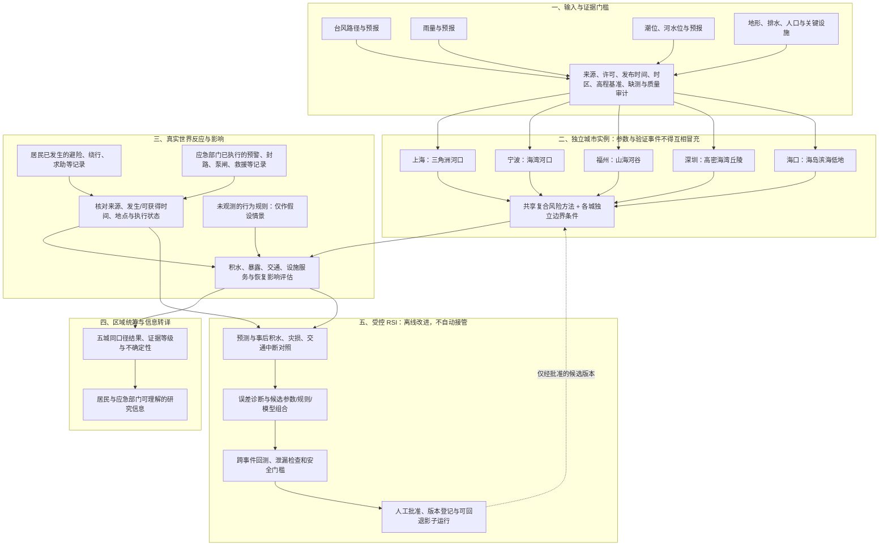

# 东南地区台风与城市内涝韧性：研究架构图

本图界定目标架构与当前实现边界，不表示所有连线已经具备真实数据或上线能力。五城范围为上海、宁波、福州、深圳、海口；区域层负责同口径比较和信息统筹，不以深圳参数直接替代其他城市。

## 当前落地状态

- **已有研究原型**：深圳部分数据、规则与模型接口；五城目录、缺失数据提示、响应记录接入口和基础结构审计。
- **尚未接入/验证**：上海、宁波、福州、海口的城市模型；五城真实居民与部门行动记录；跨城同事件的雨—潮—河—积水—交通联合验证。
- **尚未实现的闭环**：自动误差归因、跨事件回测、人工批准后的模型版本晋级和影子运行。图中 RSI 是受控目标架构，不是现有自动学习能力。
- **使用边界**：不能据此发布官方预警、执行设施调度、道路管制或救援指挥。历史路径和再分析等事后资料，必须核对当时可获得时间后才可进入回测输入。

数据来源与缺口见 [五城数据证据层](FIVE_CITY_DATA_EVIDENCE.md)，接入契约及实施门槛见 [区域研究路线](REGIONAL_RESEARCH_ROADMAP.md)。
